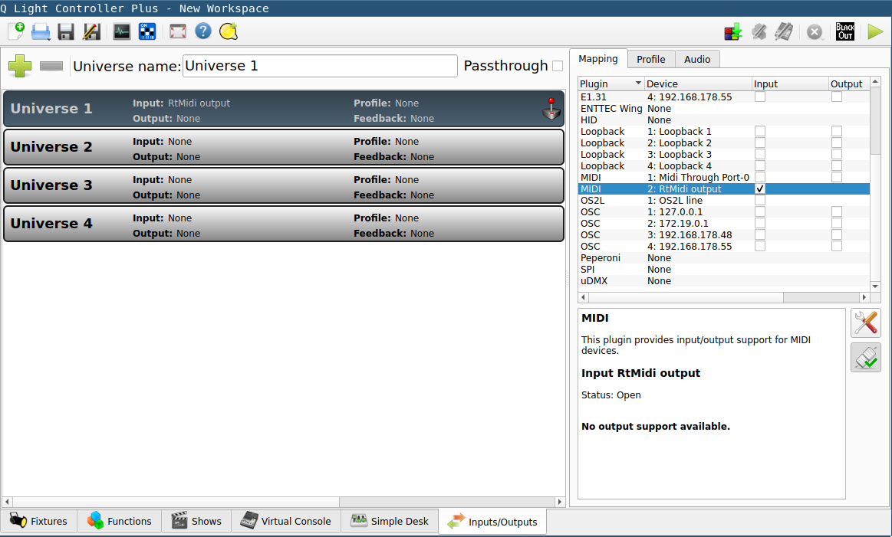

# Map mouse/keyboard to MIDI and/or Art-Net

Python script to map keyboard events and/or mouse buttons to MIDI messages in Linux, e.g., for use in QLC+.

## Prerequisites
- Linux
- `evtest`
- Python
- Python packages `mido`, `rtmidi` and `python-rtmidi` (e.g., via pip or AUR packages `python-mido` and `python-rtmidi`, requires `libasound2-dev` and `libjack-dev`)

To create a suitable virtual Python environment,
1. Run `python -m venv .venv`
1. Run `.venv/bin/pip install -r requirements.txt`

## Capturing mouse buttons and sending MIDI events
This method captures mouse events with `evdev` and sends MIDI events. Thanks to python-evdev's `grab` method, the mouse will be disabled while the script is running in order not to disturb other programs.
1. Run `sudo evtest` and select your desired device
1. Remember the input device name
1. Adapt the file `DEVICE_NAME` according to your setup and run `.venv/bin/python midimouse.py` or `python midimouse.py`

### Config mode
1. Press `left` + `middle` + `right` mouse button at the same time to enter config mode
1. You can now select the maximum scrolling value by scrolling
1. Confirm, save and leave config mode by pressing `left` + `middle` + `right` mouse button instantaneously again

## Using Art-Net messages in MadMapper/QLC+
The script will broadcast Art-Net messages on the following DMX-channels in the selected Art-Net Universe:
|Channel|Trigger                        |Value                                          |
|---    |---                            |---                                            |
|1      |Left button                    |0 (off), 255 (pressed)                         |
|2      |Middle button                  |0 (off), 255 (pressed)                         |
|3      |Right button                   |0 (off), 255 (pressed)                         |
|4      |Scrollwheel change             |Current scrollwheel value 0-255                |
|5      |(None/persistent after init)   |Scrollwheel config value                       |
|6      |Left button                    |0 (off), scrollwheel config value (pressed)    |
|7      |Middle button                  |0 (off), scrollwheel config value (pressed)    |
|8      |Right button                   |0 (off), scrollwheel config value (pressed)    |

## Using MIDI messages in QLC+
1. (Re-) Start QLC+ after running `midimouse.py`
1. Activate "RtMidi output" as Input in the Inputs/Outputs tab

1. Select Profile "None"
1. Register External Input in the properties of a button in your Virtual Console
1. Enjoy strobe, fog and more with your mouse on the dancefloor!

## Autostart
### With cron
1. Run `sudo crontab -e`
1. Add `@reboot sleep 5 && sh /home/pi/midi-mouse/midimouse.sh`
1. Append `>/home/pi/logs/cronlog 2>&1` for logging if needed (caution, may cause big log file!)

### With autostart file
Create `~/.config/autostart/midimouse.desktop` with the following content with the path adjusted to your setup to start the script upon bootup:
```
[Desktop Entry]
Type=Application
Name=evdevmidi
Exec=python <path-to-midi-mouse>/midimouse.py
StartupNotify=false
```

## Credits/Ressources
- https://askubuntu.com/a/1145638/795463
- https://unix.stackexchange.com/a/171583/310042
- https://wiki.archlinux.org/title/Map_scancodes_to_keycodes